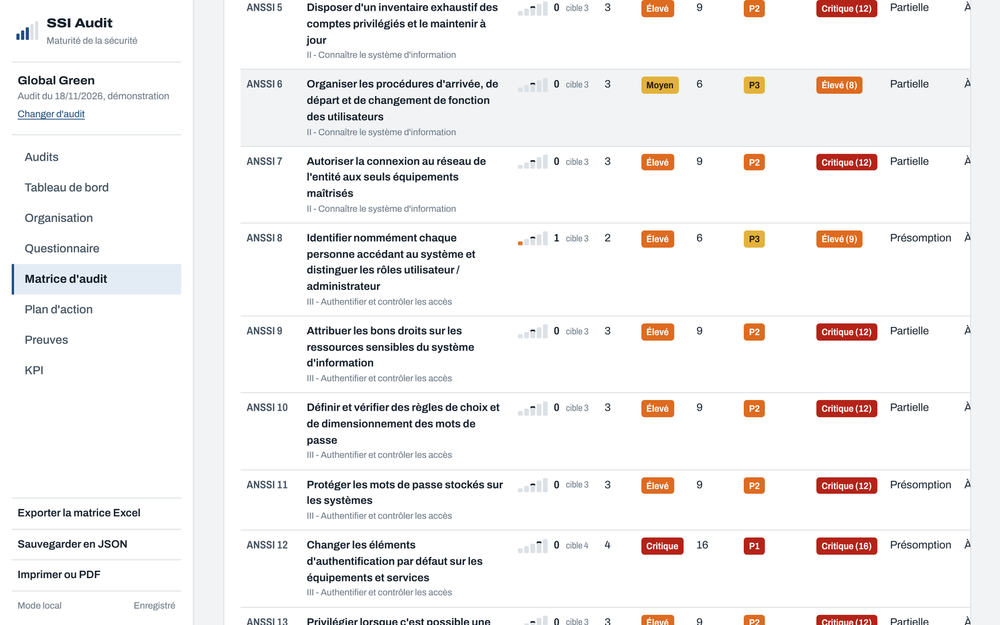
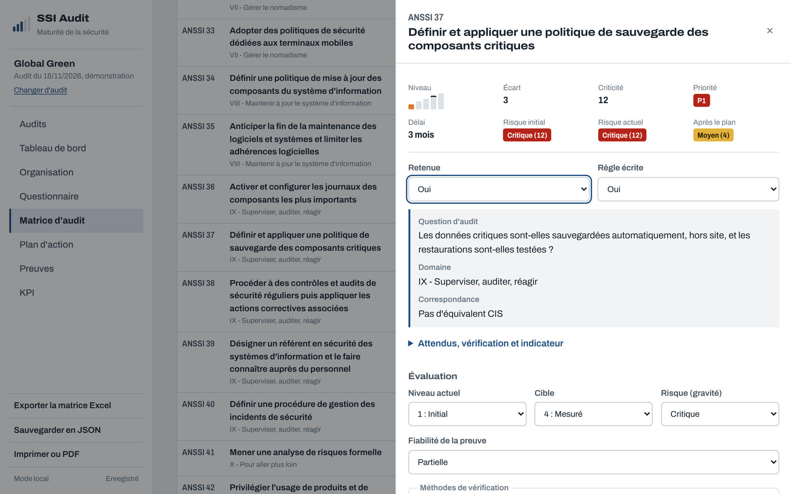
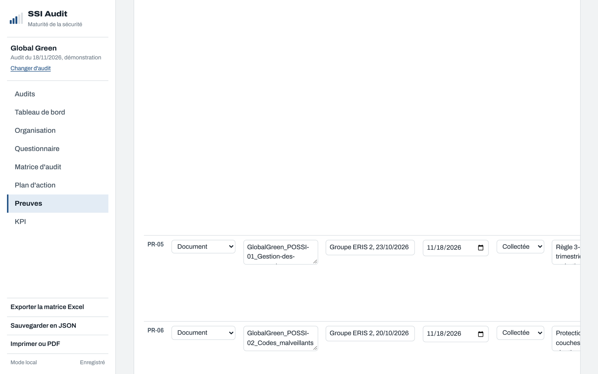
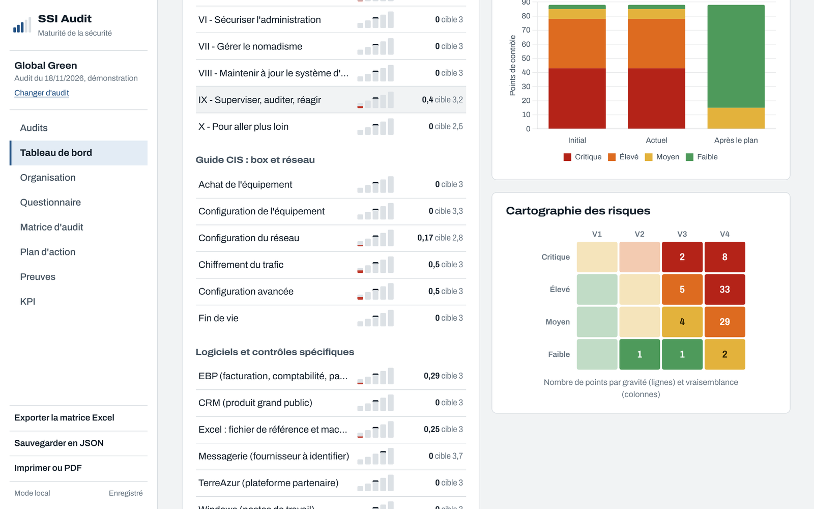
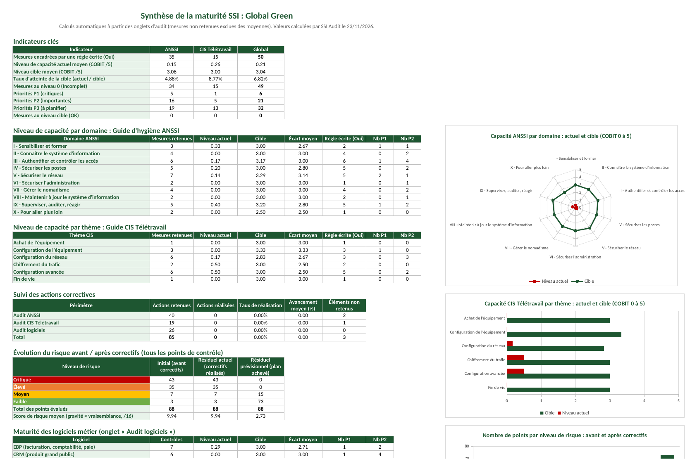

# SSI Audit : matrice de maturité ANSSI / CIS

**Outil web d'audit de maturité de la sécurité des systèmes d'information, pour les TPE et les PME.**

On évalue chaque mesure de sécurité sur l'échelle COBIT 2019. L'outil calcule ensuite les écarts, les priorités et les risques. Il construit le plan d'action et produit un classeur Excel complet. Il fonctionne directement dans le navigateur, sans installation ni compte.

**[Ouvrir l'application](https://ameliegarnier.github.io/Audit-Maturite-SSI/)** · [Répondre au questionnaire standard](https://ameliegarnier.github.io/Audit-Maturite-SSI/questionnaire.html#standard)


## Origine du projet

**SSI Audit a été conçu et développé par Amélie Garnier.**

L'outil s'appuie sur un travail de groupe réalisé dans le cadre du **Mastère ERIS (ORT Toulouse)** : la *matrice d'audit de maturité SSI* du cas d'étude **Global Green**. Ce classeur Excel a été construit par le **Groupe ERIS 2 : Julien Escarre, Tommy Soler et Amélie Garnier.**

Il contient le catalogue des mesures, les questions d'audit, les règles de calcul, le registre des preuves, la synthèse et le plan de déploiement. À partir de cette matrice, Amélie Garnier a créé une application réutilisable pour n'importe quelle organisation, avec plusieurs ajouts :

- un questionnaire en ligne en langage courant, qui génère l'audit automatiquement ;
- un tableau de bord interactif ;
- le suivi du plan d'action et des indicateurs ;
- l'export Excel au format de la matrice d'origine.

L'audit Global Green est fourni comme **jeu de démonstration**. Il reprend la matrice v1.3 : 88 points de contrôle, 29 preuves, 11 chantiers et 5 jalons. Les calculs de l'outil sont vérifiés contre ceux du classeur Excel, point par point (voir [Tests](#tests)).

## Référentiels

| Référentiel | Contenu |
|---|---|
| **Guide d'hygiène informatique de l'ANSSI** | 42 mesures, numérotation officielle, regroupées en 10 domaines |
| **CIS Telework and Small Office Network Security Guide** (v8.1) | 20 recommandations pour la box, le routeur et le Wi-Fi, au bureau comme au domicile des télétravailleurs |
| **Échelle de capacité COBIT 2019** | Niveaux 0 (Incomplet) à 5 (Optimisé) : niveau actuel constaté et cible à 12 mois |
| **Contrôles spécifiques** | Mesures ajoutées par l'auditeur, par exemple pour les logiciels métier (EBP, CRM, Excel, messagerie… dans la démo) |

## Fonctionnalités

| Module | Contenu |
|---|---|
| **Audits** | Plusieurs organisations, création depuis le catalogue, duplication, import et export JSON |
| **Organisation** | Référence, version, destinataires, classification, contexte, implantation, périmètre, acteurs, enjeux, documents de référence, points forts, historique des versions |
| **Questionnaire** | Questionnaire standard par lien fixe ou questionnaire personnalisé. Chaque personne (direction, informatique, salariés) répond en langage courant ; les réponses sont agrégées et **génèrent l'audit** |
| **Matrice d'audit** | Fiche complète par point de contrôle : question, attendus, retenue (Oui / Allégée / Non) et justification, constat, causes, conséquences, points forts, couverture documentaire, preuves, fiabilité, règle écrite, niveau et cible COBIT, gravité, DICT, 8 méthodes de vérification, action corrective et suivi |
| **Calculs automatiques** | Écart, criticité, priorité P1 à P3, risque initial, résiduel actuel et résiduel prévisionnel (gravité × vraisemblance) |
| **Tableau de bord** | Synthèse rédigée de l'audit, maturité par domaine sur l'échelle COBIT, priorités des écarts, évolution du risque, cartographie gravité × vraisemblance, critères DICT, méthodes de vérification, dix écarts les plus critiques. Chaque élément ouvre la matrice filtrée |
| **Plan d'action** | Chantiers reliés aux mesures (actions clés, responsable, échéance, coût, indicateur de réussite), activités récurrentes, jalons et critères de passage, diagramme de Gantt |
| **Preuves** | Registre PR-xx : type, source, date, statut de collecte, ce que la preuve établit, points de contrôle qui la citent |
| **KPI** | Indicateurs manuels avec historique des mesures, et indicateurs calculés à partir de la matrice |
| **Exports** | Classeur Excel au format de la matrice d'origine, JSON, impression et PDF |

| Matrice d'audit | Fiche d'un point de contrôle |
|---|---|
|  |  |

| Plan d'action et Gantt | Registre des preuves |
|---|---|
|  |  |



## Questionnaire et audit automatique

1. **Diffuser le questionnaire.**
   - Le **questionnaire standard** est un lien fixe, à utiliser sans préparation : [`questionnaire.html#standard`](https://ameliegarnier.github.io/Audit-Maturite-SSI/questionnaire.html#standard). Il pose une question par mesure ANSSI et CIS.
   - Le **questionnaire personnalisé** se crée depuis l'onglet *Questionnaire*. Il reprend les mesures retenues de l'audit et les contrôles spécifiques.
2. **Répondre.** Chaque répondant indique sa fonction. Les salariés ne voient que les questions d'usage ; la direction et la personne qui gère l'informatique voient aussi les questions techniques. Les réponses sont enregistrées en brouillon au fil de l'eau.
3. **Générer l'audit.** Les réponses sont converties en niveaux COBIT. L'écart, la criticité, la priorité, les risques, le plan d'action et le tableau de bord sont alors recalculés.

| Réponse | Niveau COBIT |
|---|---|
| Non, ce n'est pas fait | 0 · Incomplet |
| Parfois, au cas par cas | 1 · Initial |
| Oui, régulièrement, mais sans règle écrite | 2 · Géré |
| Oui, et une règle ou procédure écrite existe | 3 · Défini |
| Oui, avec une règle écrite et des contrôles réguliers | 4 · Mesuré |
| Oui, contrôlé et amélioré en continu | 5 · Optimisé |
| Je ne sais pas / Non concerné | Exclu du calcul, signalé |

Les réponses sont agrégées par **médiane** (par défaut), par **minimum** (choix prudent) ou par **moyenne**, arrondie à l'inférieur. Pour chaque mesure, l'outil :

- inscrit le détail des réponses et les commentaires dans le constat ;
- coche la méthode *Questionnaire* et marque la fiabilité *Présomption* ;
- signale les réponses **divergentes** (écart d'au moins 2 niveaux) et les questions **méconnues** (majorité de « Je ne sais pas »), à vérifier en entretien ;
- propose « non retenue » quand la majorité répond « Non concerné » ;
- ajoute la preuve au registre et propose une action corrective.

> Un audit issu d'un questionnaire est **déclaratif** : il donne une photographie rapide, à confirmer par l'examen des preuves.

| Page du répondant | Résultats et génération de l'audit |
|---|---|
|  |  |

Deux modes de collecte existent, selon l'hébergement :

| Mode | Diffusion | Collecte des réponses |
|---|---|---|
| Local (GitHub Pages) | Lien fixe (standard) ou lien contenant la liste des questions | Sur le même navigateur, intégration directe (bouton *Actualiser*) ; ailleurs, le répondant télécharge un fichier `.json` que l'auditeur importe |
| Serveur (PHP) | Lien à jeton secret (256 bits, stocké haché) | Réponses déposées sur le serveur, bouton *Actualiser* |

## Méthode de calcul

Les règles sont celles de l'onglet « Méthode » de la matrice d'origine.

| Élément | Règle |
|---|---|
| Écart | Cible − niveau actuel (0 si la cible est atteinte) |
| Criticité | Écart × poids du risque (Critique 4, Élevé 3, Moyen 2, Faible 1) |
| Priorité | P1 si criticité ≥ 12 (3 mois) · P2 de 8 à 11 (6 mois) · P3 de 1 à 7 (12 mois) · OK si la cible est atteinte |
| Vraisemblance | Niveau COBIT 0 → 4 · 1 → 3 · 2 → 2 · 3 et plus → 1 |
| Score de risque | Gravité × vraisemblance (1 à 16) : ≥ 12 Critique · 8 à 11 Élevé · 4 à 7 Moyen · 1 à 3 Faible |
| Risque résiduel actuel | Recalculé avec le niveau atteint, uniquement quand « Action réalisée » est cochée ; sinon égal au risque initial |
| Risque résiduel prévisionnel | Calculé avec la cible ; il ne descend jamais à zéro |
| Mesure non retenue | Ni écart ni priorité, exclue des moyennes ; son risque reste coté et sa justification est conservée (« Éléments non retenus ») |
| Mesure allégée | Reste évaluée ; seule la partie écartée est justifiée |

## Export Excel

**Exporter Excel** produit un classeur au format de la matrice d'origine. Il contient 11 onglets : Présentation, Méthode, Audit ANSSI, Audit CIS Télétravail, Audit logiciels, Registre des preuves, Éléments non retenus, Synthèse, Plan d'action, Plan de déploiement (Gantt) et Indicateurs.

- **Calculs :** dans les onglets d'audit, l'écart, la criticité, la priorité et les risques sont de **vraies formules Excel**. Le classeur se recalcule si on le modifie.
- **Saisie :** les cellules à remplir sont en jaune pâle, avec des listes déroulantes (retenue, fiabilité, règle écrite, niveaux, gravité, statut).
- **Couleurs :** les priorités et les niveaux de risque sont colorés par une mise en forme conditionnelle.
- **Sécurité :** le fichier est généré dans le navigateur, sans dépendance, et l'injection de formules est neutralisée.



## Démarrage

### 1. En ligne ou en local (sans serveur)

L'application est publiée sur **GitHub Pages** : <https://ameliegarnier.github.io/Audit-Maturite-SSI/>. Pour la faire tourner sur son poste, il suffit de servir le dossier :

```bash
python3 -m http.server 8000
```

puis d'ouvrir <http://localhost:8000/>.

Sans PHP, l'application passe automatiquement en **mode local** : les audits sont enregistrés dans le navigateur (`localStorage`). Pensez à les sauvegarder en JSON, car vider le cache du navigateur les efface. Pour découvrir l'outil, cliquez sur **Charger la démo**.

### 2. Serveur PHP (multi-postes, base SQLite)

Il faut PHP 8.1 ou plus récent avec `pdo_sqlite`, et Apache avec `AllowOverride All` pour que le `.htaccess` soit pris en compte.

```bash
php -S 127.0.0.1:8080
```

Lorsque `api.php` répond, l'application passe en **mode serveur** et enregistre les audits dans `data/ssi-audit.sqlite`.

Pour **protéger l'accès par mot de passe**, générez un hachage :

```bash
php -r "echo password_hash('VotreMotDePasse', PASSWORD_DEFAULT), PHP_EOL;"
```

Collez-le ensuite dans `config.php` (`password_hash`).

### 3. Docker

```bash
docker compose up -d --build
```

L'application est alors disponible sur <http://localhost:8080>.

## Sécurité

- **Navigateur :**
  - Content-Security-Policy stricte : aucun script externe ni en ligne, Chart.js hébergé localement.
  - Échappement systématique des données affichées.
  - Neutralisation de l'injection de formules dans l'export Excel.
- **API :**
  - Requêtes préparées (PDO), validation du schéma et de l'échelle COBIT.
  - Corps de requête limité à 8 Mo, identifiants filtrés par liste blanche.
  - En-tête `X-Requested-With` obligatoire et jeton CSRF sur les écritures.
- **Session :**
  - Cookie `HttpOnly` et `SameSite=Strict` (`Secure` en HTTPS), `session_regenerate_id` à la connexion.
  - Ralentissement après 5 échecs, mot de passe vérifié par `password_verify`.
- **Serveur :**
  - `data/`, `lib/` et `config.php` sont inaccessibles depuis le Web.
  - En-têtes `nosniff`, `X-Frame-Options`, `Referrer-Policy` et `Permissions-Policy`.
- **Questionnaire :**
  - Jeton aléatoire de 256 bits, stocké uniquement haché (SHA-256).
  - Réponses validées : questions connues, valeurs bornées, commentaires limités à 1 000 caractères.
  - Plafond de 500 réponses par campagne et délai minimal entre deux envois.
- **Traçabilité :** journal des enregistrements et suppressions, avec le client pseudonymisé.

> En production, placez `data/` hors de la racine web (`data_dir` dans `config.php`) et servez l'application en HTTPS.

## Architecture

```
├── index.html                 Application (page unique)
├── questionnaire.html         Page du répondant
├── api.php                    API JSON : audits et questionnaires (mode serveur)
├── login.php, config.php      Connexion et configuration (mode serveur)
├── lib/
│   ├── bootstrap.php          Session, CSRF, base SQLite, journal
│   └── questionnaire.php      Campagnes, jetons, dépôt et lecture des réponses
├── assets/
│   ├── js/calc.js             Moteur de calcul (testable sous Node)
│   ├── js/app.js              Interface, vues, graphiques
│   ├── js/export-xlsx.js      Export Excel au format de la matrice d'audit
│   ├── js/xlsx-lite.js        Générateur .xlsx autonome (styles, formules, listes)
│   ├── js/store.js            Persistance : serveur ou navigateur
│   ├── js/qshared.js          Questions, liens, agrégation des réponses
│   ├── js/questionnaire.js    Page du répondant
│   ├── data/catalog-data.js   Mesures ANSSI et CIS (question, attendus, méthode, indicateur, gravité, cible, DICT)
│   ├── data/catalog.js        Listes de valeurs, KPI par défaut
│   ├── data/questions.js      Questions en langage courant et échelle de réponse
│   ├── data/demo-globalgreen.js  Démonstration : audit Global Green (matrice v1.3)
│   ├── css/style.css          Styles (thèmes clair et sombre, ordinateur et téléphone)
│   ├── fonts/                 Police Archivo auto-hébergée (licence SIL OFL)
│   └── vendor/chart.umd.min.js   Chart.js 4 (licence MIT)
├── tests/
│   ├── calc.test.js           Tests du moteur
│   └── fixtures/              Valeurs calculées par la matrice Excel Global Green
├── docs/captures/             Captures d'écran
└── Dockerfile, docker-compose.yml
```

## Tests

```bash
node tests/calc.test.js
```

Les tests vérifient les règles de calcul. Ils comparent aussi l'outil à la **matrice Excel d'origine** :

- les **88 points de contrôle** sont identiques (écart, criticité, priorité, risque initial, actuel et prévisionnel) ;
- les **indicateurs de la synthèse** sont identiques : niveaux par domaine, par thème et par logiciel, priorités, évolution du risque, DICT et méthodes de vérification.

## Limites

- Les intitulés ANSSI et CIS sont résumés ou reformulés en français : se reporter au [guide d'hygiène de l'ANSSI](https://cyber.gouv.fr/publications/guide-dhygiene-informatique) et au guide CIS pour le texte de référence.
- Seule l'échelle de capacité de COBIT 2019 est utilisée, pas le référentiel complet.
- En mode local, les données restent dans un seul navigateur : exportez-les régulièrement.
- Les graphiques sont dans l'application ; l'export Excel contient les tableaux de synthèse, sans graphiques.

## Autrice et crédits

- **Conception et développement de l'outil :** Amélie Garnier.
- **Matrice d'audit de maturité SSI Global Green** (classeur Excel d'origine, catalogue, méthode et jeu de démonstration) : Groupe ERIS 2, composé de Julien Escarre, Tommy Soler et Amélie Garnier. Mastère ERIS, ORT Toulouse.
- **Chart.js** © Chart.js Contributors, licence MIT.
- **Archivo** © The Archivo Project Authors, licence SIL Open Font License 1.1.

## Licence

Code sous licence MIT : voir [`LICENSE`](LICENSE).
