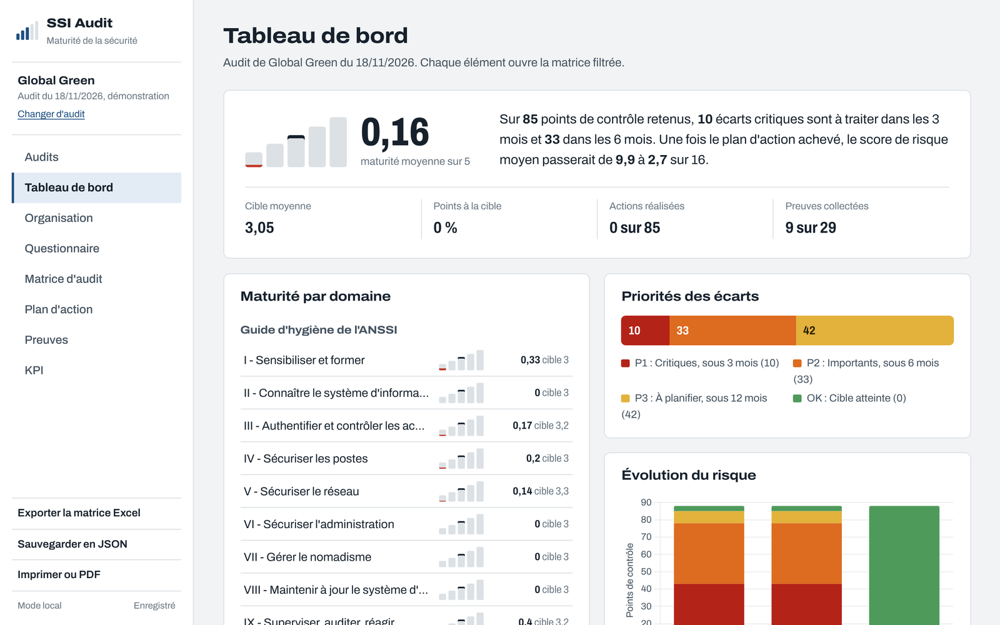
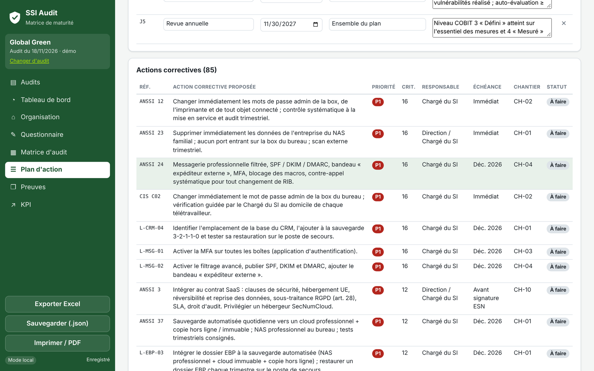
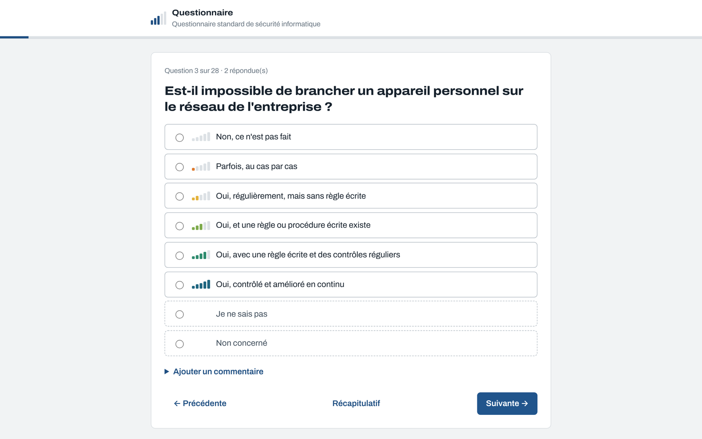
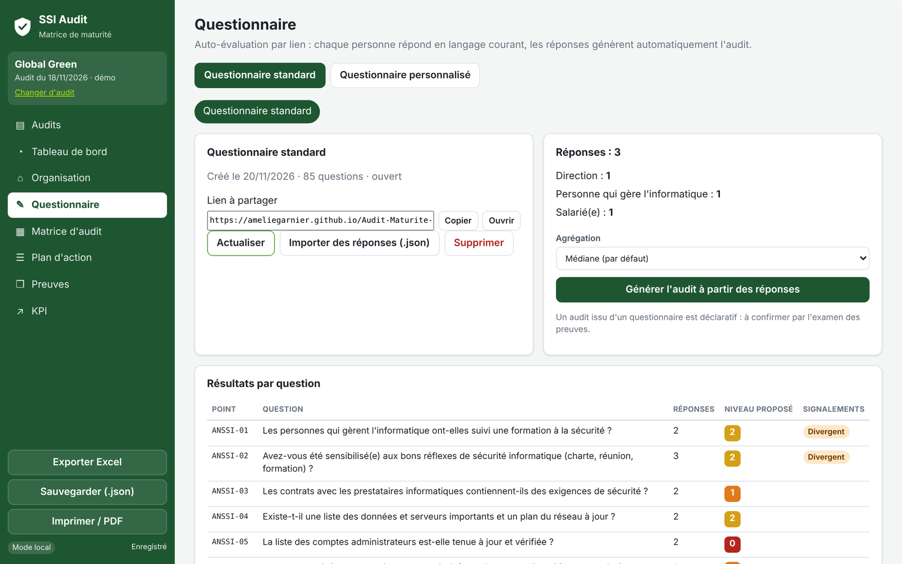

# SSI Audit : matrice de maturité ANSSI / CIS

Outil web d'**audit de maturité de la sécurité des systèmes d'information** pour TPE et PME. Il s'appuie sur :

- le **guide d'hygiène informatique de l'ANSSI** (42 mesures) ;
- le guide **CIS Telework and Small Office Network Security** (20 recommandations) ;
- l'**échelle de capacité COBIT 2019** (niveaux 0 à 5).

Il produit l'évaluation, le plan d'action, le registre des preuves et des indicateurs de suivi, le tout avec des graphiques interactifs.

> Projet issu d'un travail réalisé dans le cadre du Mastère ERIS (ORT Toulouse) sur le cas d'étude *Global Green* (Groupe ERIS 2 : Julien Escarre, Tommy Soler, Amélie Garnier), inclus comme jeu de démonstration.



## Fonctionnalités

| Module | Contenu |
|---|---|
| **Audits** | Plusieurs organisations, création depuis le catalogue, duplication, import et export JSON |
| **Questionnaire** | Auto-évaluation par lien : chaque personne (direction, informatique, salariés) répond en langage courant ; les réponses sont agrégées et **génèrent automatiquement l'audit** |
| **Organisation** | Identification, classification, contexte, périmètre, référentiels activés, historique des versions |
| **Matrice d'audit** | Les mesures sont chargées depuis un catalogue (voir ci-dessous). Fiche complète par point : question d'audit, attendus, méthodes de vérification, DICT, décision, constat, preuves, niveau et cible COBIT, gravité, action corrective et suivi |
| **Calculs automatiques** | Écart, criticité, priorité P1 à P3, risque initial, actuel et après plan (gravité × vraisemblance), exclusion des mesures non retenues |
| **Tableau de bord** | Radar par domaine, priorités, écarts, évolution du risque, cartographie gravité × vraisemblance, DICT, méthodes, top 10 des écarts, trajectoire. Les graphiques sont cliquables et ouvrent la matrice filtrée |
| **Plan d'action** | Chantiers reliés aux mesures, diagramme de Gantt (chantiers, activités récurrentes, jalons), avancement, actions triées par criticité |
| **Preuves** | Registre PR-xx avec statut de collecte et renvoi vers les points de contrôle qui les citent |
| **KPI** | Indicateurs manuels avec historique des mesures, et indicateurs calculés automatiquement à partir de la matrice. Graphiques d'atteinte des cibles et d'évolution |
| **Exports** | Classeur Excel multi-onglets (généré sans dépendance), JSON, impression et PDF |

Le **catalogue** chargé à la création d'un audit comprend les 42 mesures ANSSI et les 20 recommandations CIS, avec pour chacune la question d'audit, les attendus, la méthode de vérification, l'indicateur et une cible suggérée. On peut y ajouter ses propres contrôles, par exemple les logiciels métier.

| Matrice | Fiche d'un point de contrôle |
|---|---|
|  |  |

| Plan d'action et Gantt | Indicateurs (KPI) |
|---|---|
|  |  |

## Questionnaire et audit automatique

0. **Questionnaire standard** : un lien fixe, sans préparation, avec les 62 questions ANSSI + CIS : `questionnaire.html#standard`. Les réponses (fichier `.json` téléchargé par le répondant, ou directement sur le même navigateur) s'importent dans n'importe quel audit via *Questionnaire → Questionnaire standard*.
1. **Créer** un questionnaire personnalisé depuis l'onglet *Questionnaire* : une question en langage courant par mesure retenue (62 pour ANSSI + CIS, plus les contrôles spécifiques).
2. **Partager** le lien. Chaque répondant indique sa fonction : les salariés ne voient que les questions d'usage (≈ 25), la direction et la personne qui gère l'informatique voient aussi les questions techniques. Les réponses sont enregistrées en brouillon au fil de l'eau.
3. **Générer l'audit** : les réponses sont converties en niveaux COBIT, puis écart, criticité, priorité, risques, plan d'action et tableau de bord sont recalculés.

| Réponse | Niveau COBIT |
|---|---|
| Non, ce n'est pas fait | 0 · Incomplet |
| Parfois, au cas par cas | 1 · Initial |
| Oui, régulièrement, mais sans règle écrite | 2 · Géré |
| Oui, et une règle ou procédure écrite existe | 3 · Défini |
| Oui, avec une règle écrite et des contrôles réguliers | 4 · Mesuré |
| Oui, contrôlé et amélioré en continu | 5 · Optimisé |
| Je ne sais pas / Non concerné | exclu du calcul, signalé |

L'agrégation se fait au choix par **médiane** (par défaut), **minimum** (prudent) ou **moyenne**, arrondie à l'inférieur. Pour chaque mesure, l'outil :
- inscrit dans le constat le détail des réponses et les commentaires ;
- coche la méthode *Questionnaire* et marque la fiabilité *Présomption* ;
- signale les réponses **divergentes** (écart ≥ 2 niveaux) et les questions **méconnues** (majorité de « Je ne sais pas ») à vérifier en entretien ;
- propose « non retenue » quand la majorité répond « Non concerné » ;
- ajoute la preuve au registre et propose une action corrective.

> Un audit issu d'un questionnaire est **déclaratif** : il donne une photographie rapide, à confirmer par l'examen des preuves.

| Mode | Diffusion | Collecte |
|---|---|---|
| Serveur (PHP) | Lien à jeton secret (256 bits, stocké haché) | Réponses déposées sur le serveur, bouton *Actualiser* |
| Local (GitHub Pages) | Lien contenant la liste des questions | Sur le même appareil : intégration directe ; ailleurs : le répondant télécharge un fichier `.json` que l'auditeur importe |

| Page du répondant | Résultats et génération de l'audit |
|---|---|
|  |  |

## Méthode de calcul

| Élément | Règle |
|---|---|
| Écart | Cible − niveau actuel (0 si la cible est atteinte) |
| Criticité | Écart × poids du risque (Critique 4, Élevé 3, Moyen 2, Faible 1) |
| Priorité | P1 ≥ 12 (3 mois) · P2 8 à 11 (6 mois) · P3 1 à 7 (12 mois) · OK |
| Vraisemblance | Niveau COBIT 0 → 4 · 1 → 3 · 2 → 2 · ≥ 3 → 1 |
| Score de risque | Gravité × vraisemblance (1 à 16) : ≥ 12 Critique · 8 à 11 Élevé · 4 à 7 Moyen · 1 à 3 Faible |
| Risque actuel | Recalculé avec le niveau atteint lorsque l'action est réalisée |
| Risque après plan | Calculé avec la cible ; il ne descend jamais à zéro |

Le moteur (`assets/js/calc.js`) reproduit à l'identique les résultats de la matrice Excel d'origine : 88 points de contrôle sur 88 vérifiés.

## Déploiement

### 1. Démo statique (GitHub Pages, ouverture locale)

Il suffit de copier le dossier tel quel. Sans PHP, l'application passe automatiquement en **mode local** : les audits sont enregistrés dans le navigateur (`localStorage`). Pensez à les exporter en JSON pour les sauvegarder.

```text
https://<utilisateur>.github.io/<depot>/
```

### 2. Serveur PHP (multi-postes, base SQLite)

Prérequis : PHP 8.1 ou plus récent avec `pdo_sqlite`, et Apache avec `AllowOverride All` pour que le `.htaccess` soit pris en compte.

```bash
php -S 127.0.0.1:8080        # test local
```

Lorsque `api.php` répond, l'application passe en **mode serveur** et enregistre les audits dans `data/ssi-audit.sqlite`.

Pour **protéger l'accès par mot de passe** :

```bash
php -r "echo password_hash('VotreMotDePasse', PASSWORD_DEFAULT), PHP_EOL;"
```

Collez ensuite le hachage obtenu dans `config.php` (`password_hash`).

### 3. Docker

```bash
docker compose up -d --build   # http://localhost:8080
```

## Sécurité

- **Front-end :**
  - Content-Security-Policy stricte (aucun script externe ni inline).
  - Échappement systématique des données affichées.
  - Neutralisation de l'injection de formules dans l'export Excel.
  - Chart.js hébergé localement.
- **API :**
  - Requêtes préparées (PDO).
  - Validation du schéma et de l'échelle COBIT.
  - Taille de corps limitée à 8 Mo.
  - Identifiants filtrés par liste blanche.
  - En-tête `X-Requested-With` obligatoire et jeton CSRF sur les écritures.
- **Session :**
  - Cookie `HttpOnly` et `SameSite=Strict` (`Secure` en HTTPS).
  - `session_regenerate_id` à la connexion.
  - Ralentissement après 5 échecs.
  - Mot de passe vérifié par `password_verify`.
- **Serveur :**
  - `data/`, `lib/` et `config.php` sont inaccessibles depuis le Web.
  - En-têtes `nosniff`, `X-Frame-Options`, `Referrer-Policy` et `Permissions-Policy`.
- **Questionnaire :**
  - Accès public limité par un jeton aléatoire de 256 bits, stocké uniquement haché (SHA-256).
  - Le jeton permet seulement de lire les questions et de déposer une réponse.
  - Réponses validées : identifiants de questions connus, valeurs bornées, commentaires limités à 1 000 caractères.
  - Plafond de 500 réponses par campagne et délai minimal entre deux envois.
  - Campagne refermable à tout moment.
- **Traçabilité :** journal des enregistrements et suppressions, avec le client pseudonymisé par hachage.

> En production, placez `data/` hors de la racine web (`data_dir` dans `config.php`) et servez l'application en HTTPS.

## Architecture

```
ssi-audit/
├── index.html              Application (page unique)
├── api.php                 API JSON : ping, list, get, save, delete
├── questionnaire.html      Page du répondant (auto-évaluation)
├── login.php               Connexion (si mot de passe configuré)
├── config.php              Configuration (mot de passe, dossier de données)
├── lib/bootstrap.php       Session, CSRF, base SQLite, journal
├── lib/questionnaire.php   Campagnes, jetons, dépôt et lecture des réponses
├── assets/
│   ├── js/calc.js          Moteur de calcul (testable sous Node)
│   ├── js/app.js           Interface, vues, graphiques, exports
│   ├── js/store.js         Persistance : serveur ou navigateur
│   ├── js/qshared.js       Questions, encodage des liens, agrégation des réponses
│   ├── js/questionnaire.js Page du répondant
│   ├── data/questions.js   Questions en langage courant et échelle de réponse
│   ├── js/xlsx-lite.js     Générateur .xlsx autonome (ZIP + OOXML)
│   ├── data/catalog.js     Catalogue ANSSI / CIS et KPI par défaut
│   ├── data/demo-globalgreen.js  Jeu de démonstration
│   └── vendor/chart.umd.min.js   Chart.js 4 (licence MIT)
├── data/                   Base SQLite (créée automatiquement)
├── tests/calc.test.js      Tests du moteur (node tests/calc.test.js)
├── Dockerfile, docker-compose.yml
└── docs/captures/
```

## Limites

- Les intitulés ANSSI et CIS sont résumés ou reformulés en français : se reporter aux [guides officiels](https://cyber.gouv.fr/publications/guide-dhygiene-informatique) pour le texte de référence.
- Seule l'échelle de capacité de COBIT 2019 est utilisée, pas le référentiel complet.
- Le mode local conserve les données dans un seul navigateur : exportez-les régulièrement.

## Licence

Code sous licence MIT (voir `LICENSE`). Chart.js © Chart.js Contributors, licence MIT.
